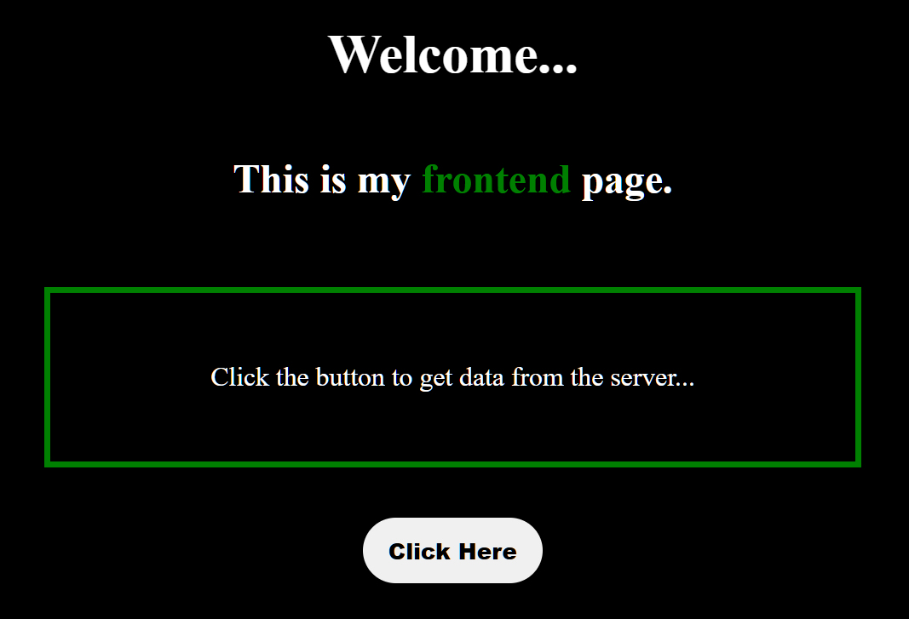
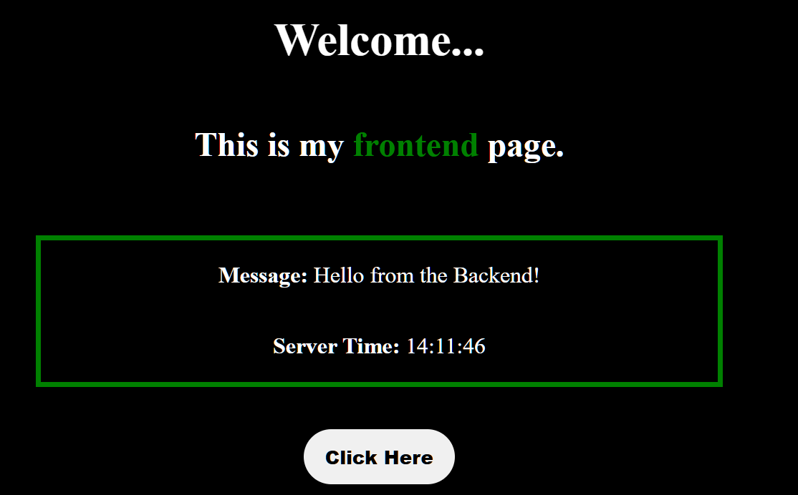

# 🌐 Basic Express Server 🚀

A simple full-stack project to understand how **Frontend ↔ Backend communication** works.

Click a button on the frontend and get data from the backend ⚡

## ✨ Features

* 🎨 Simple Frontend (HTML, CSS, JS)
* ⚙️ Express Backend (Node.js)
* 🔁 Fetch API for communication
* 🖱️ Button click triggers API call
* ⏱️ Displays server message + time


## 🚀 How to Run This Project

### 1️⃣ Clone the Repository

```bash
git clone https://github.com/Saksham-Sharma-webdev/Basic-NodeJs-Backend-Server
```

### 2️⃣ Go to Project Folder

```bash
cd "Basic Express Server"
```

### 3️⃣ Install Backend Dependencies

```bash
cd Backend
npm install
```

### 4️⃣ Start the Server

```bash
node server.js
```

👉 Server will start (usually at http://localhost:3000)

---

### 🌍 Open the Frontend

📂 Go to the `Frontend` folder

🖱️ Open the `index.html` file in your browser

👉 OR (Recommended ⚡)

💻 Use **Live Server** in VS Code:

* Right click on `index.html`
* Click **"Open with Live Server"**

🚀 This will open your app in the browser.

---

### ⚠️ Important

Make sure your backend server is running before opening the frontend
Otherwise data will not be fetched ❌

---

## 📸 Screenshots





## ⭐ Support

If you found this project helpful, please consider giving it a star ⭐ on GitHub!

---

**Made with ❤️ using JavaScript 🚀**
